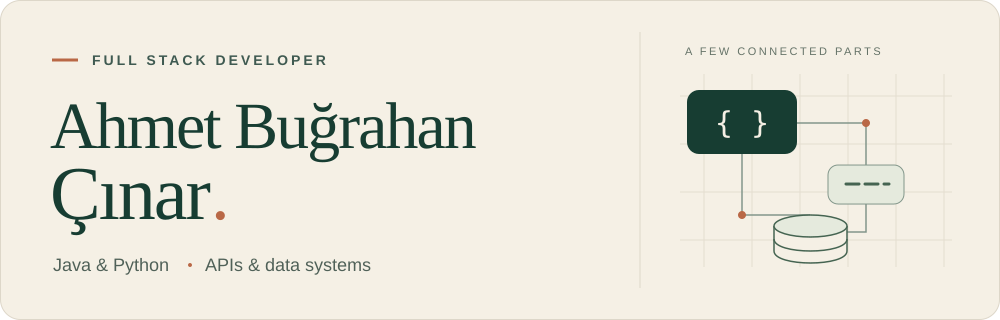

<picture>
  <source media="(prefers-color-scheme: dark) and (max-width: 600px)" srcset="./assets/header-dark-mobile.svg">
  <source media="(max-width: 600px)" srcset="./assets/header-light-mobile.svg">
  <source media="(prefers-color-scheme: dark)" srcset="./assets/header-dark.svg">
  
</picture>

  <a href="https://bugracinar.dev"><strong>Portfolio</strong></a>
  &nbsp; / &nbsp;
  <a href="https://www.linkedin.com/in/ahmetbugrahancinar/">LinkedIn</a>
  &nbsp; / &nbsp;
  <a href="mailto:ahmetbugrahancinarr@gmail.com">Email</a>

I build web applications end to end: **React / TypeScript** on the frontend, with **Java / Spring Boot** or **Python / FastAPI** on the backend. My work connects usable interfaces, modular APIs and reliable data flows.

I like clear module boundaries, explicit permissions and tests that exercise real behavior — from a refresh-token rotation to a warehouse stock transfer.

### Selected work

Three related projects under **Modular Forge**, built around replaceable modules and documented boundaries.

| Project | What it does | Built with |
| :--- | :--- | :--- |
| **[FastAPI Starter](https://github.com/BugraCinar/modular-forge-fastapi-starter)** | Modular REST API foundation with rotating refresh tokens, TOTP, Redis rate limiting and SQL / MongoDB adapters. | Python · FastAPI · SQLAlchemy |
| **[Spring Boot Starter](https://github.com/BugraCinar/modular-forge-spring-boot-starter)** | Java backend foundation with Spring Security, optional feature modules and database-specific profiles. | Java · Spring Boot · Spring Security |
| **[RAG Starter](https://github.com/BugraCinar/modular-forge-rag-starter)** | Document ingestion and tenant-aware hybrid retrieval, with access-controlled evidence and cited answers. | Python · PostgreSQL · pgvector |

### On my workbench

**Depo — warehouse management.** A multi-tenant system covering inventory, warehouse transfers, purchasing, stock counts and barcode scanning, with company-specific roles and a web interface.

The interesting part: keeping stock movements consistent, permissions scoped and everyday operations straightforward.

### Tools I work with

| Area | Technologies |
| :--- | :--- |
| Backend | `Java` `Spring Boot` `Spring Security` `Python` `FastAPI` |
| Data | `PostgreSQL` `MySQL` `MariaDB` `MongoDB` `Redis` `pgvector` |
| Delivery | `Docker` `GitHub Actions` `OpenAPI` |
| Web | `TypeScript` `React` `Vite` |

### What I pay attention to

- **Access boundaries:** tenant isolation, role checks and session revocation.
- **State changes:** transactions, migrations and predictable failure behavior.
- **Maintainability:** small interfaces, replaceable adapters and integration tests against real databases.

---

  More projects and background at <a href="https://bugracinar.dev">bugracinar.dev</a>.

